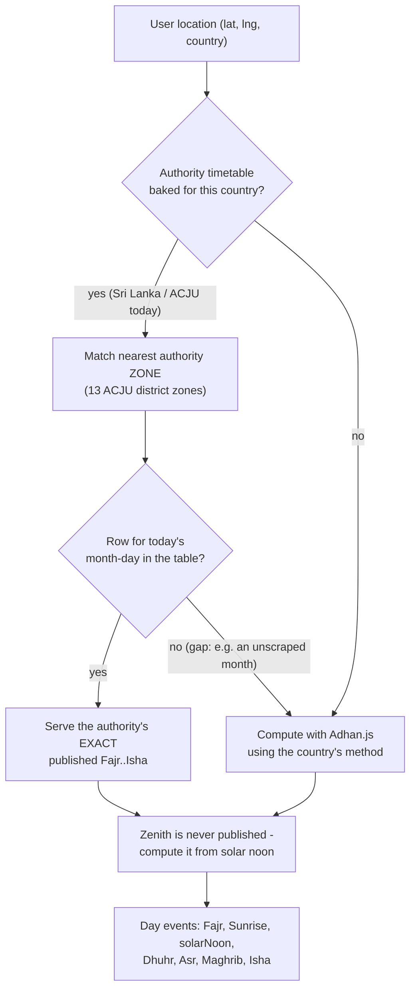
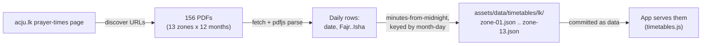
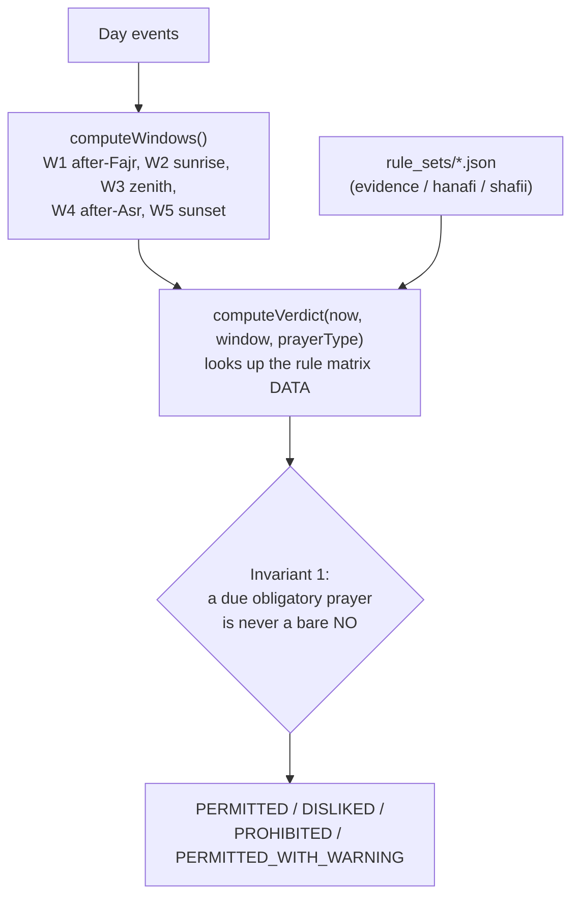

# canipraynow.com

Single-purpose, mobile-first web utility answering one question for Muslims: **"Is it permissible for me to pray right now?"** - the inverse of a prayer-times app. The answer is conditioned on **what** you intend to pray (obligatory, missed, funeral, mosque-greeting, or voluntary) and, where you follow one, **which school**. Times are the authority's own where we have them, computed astronomically otherwise; live, offline-capable, zero trackers.

Built and operated by Asymm Systems (Pvt) Ltd. Product specification: `canipraynow/product/product-specification-initial.md`.

## Status

The rulings are **evidence-based**: each rests on the Qurʾān and authentic Sunnah, cited and linked on `/methodology` and inside the rule-set data (every reference verified against its published text on sunnah.com / quran.com). They have not yet been signed off by a named scholar - when one reviews the matrix, `verified_by` / `verified_at` are set in the three `rule_sets/*.json` files and the footer shows their name. Nothing fabricates verification.

## Stack

Same pipeline as asymm-corporate-code-pfw - deliberately npm-free:

- **JBake 2.7 + FreeMarker** bake all pages (Maven plugin)
- **Dart Sass** compiles `src/main/scss/style.scss`
- **CSS minify + HTML compress** in `process-resources`; production profile strips `.html` for clean URLs
- **Client app**: hand-written vanilla ES modules with JSDoc types, no bundler, no framework. The only runtime dependency is [Adhan.js](https://github.com/batoulapps/adhan-js) 4.4.4, vendored as a single ESM file
- **Cloudflare Pages** hosting; `functions/` holds the only server code (`/api/geo` location fallback, `/go/{id}` click counter)

## How prayer times are sourced and calculated

This is the heart of the product, so it is worth being precise. Two things are computed for the user's coordinates and date: the **five prayer times** shown in the sidebar, and the **five restricted windows** (`awqāt al-nahy`) that drive the verdict. They come from different places.

### Where the five prayer times come from

The app prefers a national **authority's own published timetable** where we have scraped it, and falls back to astronomical computation otherwise. Everything is on-device - no prayer-times API is ever called at runtime.



`extracted-official` (authority's real numbers) → `fitted-to-authority` (Adhan.js with angles fitted to an authority's tables, e.g. ACJU's Fajr 20° / Isha 18°) → `computed` (a standard method preset). The full per-country breakdown, and which source each uses, is generated into `research/prayer-time-coverage.md` and published on the site at `/data-sources`.

### The yearly authority scrape (once a year, off-build)

`scripts/fetch-timetables.mjs` fetches an authority's published PDFs, parses them, and bakes per-zone year tables into `assets/data/timetables/<cc>/`. It is a **data tool, not part of the Maven build** - it hits third-party sites, so it must never be able to fail a build. Run it about once a year, review the diff, commit the JSON.



Run it: `npm i pdfjs-dist@4.0.379` once (dev-only, git-ignored), then `make timetables`. Zone tables are ~2 kB gzipped each and only the user's own zone is fetched.

### The verdict pipeline (always computed, always on-device)

The restricted windows are pure astronomy - authorities do not disagree about when the sun rises, peaks, or sets - so the verdict is computed the same way everywhere.



The **ruling basis** is data, not code. The default `evidence` ruleset is the ahl-al-hadith / evidence-based position (one ruling for everyone); Ḥanafī and Shāfiʿī ship as explicit alternatives. Each matrix cell carries its `basis` prose and an `evidence` list of primary-source ids, resolved from the ruleset's `evidences` map (Qurʾān + Sahih hadith, each with a sunnah.com/quran.com URL). A build-time test fails on any cell that cites a source not in the map.

## Architecture & decisions

The full architecture (system context, build pipeline, runtime data flow, module
map, deploy) with diagrams lives in the project workspace, alongside product and
research, mirroring the sibling M360 project's layout:

- `canipraynow/architecture/architecture.md` - the documented architecture.
- `canipraynow/architecture/decision/` - the ADRs (why each decision was made):
  on-device/no-API, npm-free stack, authority timetables, evidence-based ruleset,
  calculation methods, offline PWA, GitFlow, and the mobile-app strategy.
- `canipraynow/architecture/calculation-methods-matrix.md` - the 14 methods, their
  angles, whether any API is called (none), and each country's default method.

## Build

```sh
make build         # dev build -> target/site (browsable, .html links)
make release       # production build (strips .html for Cloudflare clean URLs)
make dev           # live-reload server on http://localhost:8020
make check         # lint + fiqh engine tests + release (what CI runs)
make verify        # release, then report budgets and broken internal links
```

`make help` lists every target. The app's ES modules must be served over HTTP (not `file://`) - `import` and the `fetch` for rule sets / strings / timetables are blocked on the file protocol; `make dev` serves them.

## Data tools (network, off-build - run occasionally, commit the diff)

```sh
make timetables    # scrape authority PDFs -> assets/data/timetables/  (needs pdfjs-dist)
make coverage      # regenerate research/prayer-time-coverage.md + the /data-sources page
```

## Layout

```
src/main/jbake/
├─ content/            # index (app), methodology, data-sources, privacy, 404, q/*, cities; {country}/{city} are generated
├─ templates/          # page/app|page|question|city|cities.ftl, partial/header|app.ftl, sitemap
└─ assets/
   ├─ js/engine/       # pure fiqh engine: windows.js, verdict.js (zero DOM)
   ├─ js/ui/           # status, chips, ruler (the Sun Ruler), prayers, settings, sponsor
   ├─ js/              # main.js boot+loop, astronomy.js, timetables.js, location, storage, strings, utils
   ├─ data/            # rule_sets/{evidence,hanafi,shafii}.json, cities.json, method-defaults, timetables/<cc>/, sponsors
   └─ sw.js, manifest.webmanifest, fonts/, images/
functions/             # Cloudflare Pages Functions (api/geo.js, go/[id].js)
scripts/               # GenerateCityPages.java (fan-out), fetch-timetables.mjs, coverage-report.py, test-engine.mjs, clean-urls.sh
```

## Fiqh safety invariants (spec §3.6, tested in `scripts/test-engine.mjs`)

1. "Today's fard" while its time runs never renders a bare NO - enforced defensively in `engine/verdict.js` even against rule-data errors.
2. The zenith window derives from astronomical solar noon only, never a timetable (including an authority's).
3. Every verdict carries its rule-set version; the footer renders it.
4. Every primary-source id a cell cites must exist in the ruleset's `evidences` map - a dangling citation fails the build.
5. Restricted countdowns point at the instant the selected prayer type actually becomes permitted (`permittedAt`), not merely the current window's edge.

## Generated content (derived, not hand-edited)

- **City pages** - `GenerateCityPages.java` fans `assets/data/cities.json` out into `content/{country}/{city}.html` at `generate-sources` (single-file source launch, no compile, no deps). Git-ignored; regenerated every build. The `/cities` index and the SEO title/prose live in `page/city.ftl` / `page/cities.ftl`.
- **Compiled CSS** - `style.scss` -> `assets/css/style.css`, git-ignored.

## Deploy (GitFlow)

GitHub Actions, same flow as asymm-corporate:

- PRs to `develop`/`main` -> `validate.yml` (Maven build + JS/JSON syntax gate + **fiqh engine tests**).
- Push to `develop` -> Cloudflare Pages **preview** deploy.
- Tag on `main` (date-based, `DD.MM.YYYY-N`) -> **production** deploy.

Secrets: `CLOUDFLARE_API_TOKEN`, `CLOUDFLARE_ACCOUNT_ID`. The `/go/` counter expects a KV namespace bound as `SPONSOR_CLICKS` (optional - redirects work without it).

## Deferred work

See `canipraynow/task/`: `authority-alignment.md` (more authorities beyond ACJU), `scholar-verification.md`, `full-test-suite.md` (Playwright/Lighthouse in CI), `city-dataset-expansion.md`, `asset-polish.md`.
