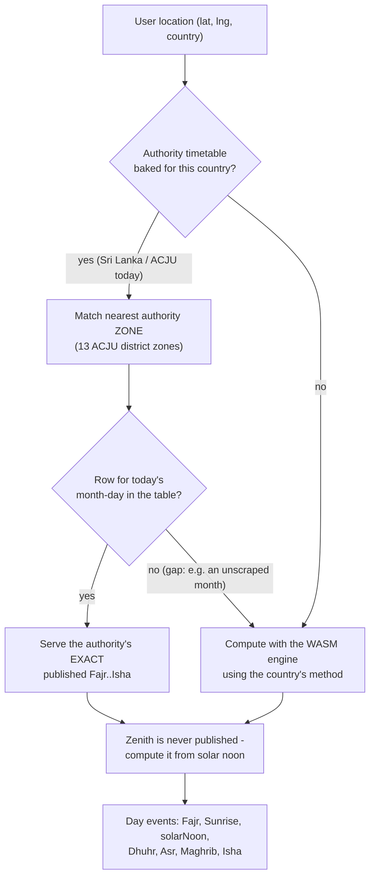
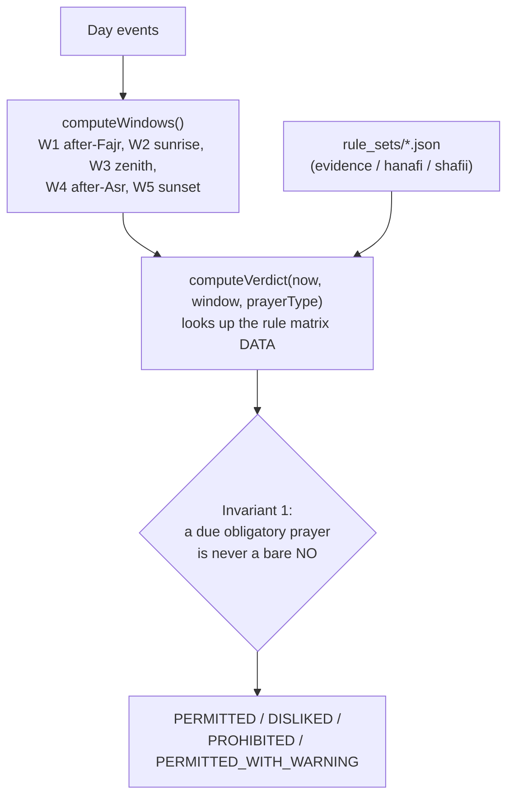

# canipraynow.com

Single-purpose, mobile-first web utility answering one question for Muslims: **"Is it permissible for me to pray right now?"** - the inverse of a prayer-times app. The answer is conditioned on **what** you intend to pray (obligatory, missed, funeral, mosque-greeting, or voluntary) and, where you follow one, **which school**. Times are the authority's own where we have them, computed astronomically otherwise; live, offline-capable, zero trackers.

Built and operated by Asymm Systems (Pvt) Ltd. Product specification: `canipraynow/product/product-specification-initial.md`.

## Status

The rulings are **evidence-based**: each rests on the Qurʾān and authentic Sunnah, cited and linked on `/methodology` and inside the rule-set data (every reference verified against its published text on sunnah.com / quran.com). They have not yet been signed off by a named scholar - when one reviews the matrix, `verified_by` / `verified_at` are set in the three `rule_sets/*.json` files and the footer shows their name. Nothing fabricates verification.

## Stack

A Maven multi-module reactor (framework / service / wiring / application), npm-free, built on the Eliya JDK; **Make orchestrates** the pipeline, Maven builds the modules (ADR-0014):

- **JBake 2.7 + FreeMarker** bake all pages; **Dart Sass** compiles `src/main/scss/style.scss`; CSS/HTML are minified in `process-resources` and the production profile strips `.html` for clean URLs.
- **Client app**: hand-written vanilla ES modules with JSDoc types, no bundler, no framework. The prayer-time engine is the project's own Java astronomy engine compiled to **WebAssembly-GC** (TeaVM), loaded lazily for the fallback only (ADR-0015); there is no adhan.js.
- **Data is XML on the classpath** (ADR-0012): `city.xml`, `country.xml`, `calculation-method.xml`, and `timetable/<year>/<cc>/*.xml`. No client-side JSON.
- **Cloudflare Pages** hosting; a standalone Cloudflare **Worker** (`application/cipn-app-fn`, ADR-0013) serves `/api/geo` (location fallback) and `/go/{id}` (click counter).

## How prayer times are sourced and calculated

This is the heart of the product, so it is worth being precise. Two things are computed for the user's coordinates and date: the **five prayer times** shown in the sidebar, and the **five restricted windows** (`awqāt al-nahy`) that drive the verdict. They come from different places.

### Where the five prayer times come from

The app prefers a national **authority's own published timetable** where we have scraped it, and falls back to astronomical computation otherwise. Everything is on-device - no prayer-times API is ever called at runtime.



`extracted-official` (authority's real numbers) → `fitted-to-authority` (the engine with angles fitted to an authority's tables, e.g. ACJU's Fajr 20° / Isha 18°) → `computed` (a standard method preset). The full per-country breakdown, and which source each uses, is generated into `research/prayer-time-coverage.md` and published on the site at `/data-sources`.

### The yearly authority scrape (S1, off-build)

The authority scraper (S1) is **native Java** (`make scrape CC=my YEAR=2027`; JAKIM pilot, ADR-0017): one `AuthorityScraper` implementation per authority fetches its published tables and normalises them into standard **XML** under `timetable/<year>/<cc>/` on the classpath (ADR-0012), XSD-validated against the framework schema, then a **golden-diff** compares each zone against the last committed table so a moved endpoint or parser regression is caught before commit. It is a data tool, not part of the Maven build - it hits third-party sites, so it must never be able to fail a build. Run it about once a year and review the diff. LK/ACJU (13 district zones) and MY/JAKIM data are already migrated; the JAKIM scraper (e-Solat JSON API) is the built pilot, and each further authority in the register is one more implementation of the same contract. At runtime a covered city reads its baked table from the page (R1); nothing is fetched.

### The verdict pipeline (always computed, always on-device)

The restricted windows are pure astronomy - authorities do not disagree about when the sun rises, peaks, or sets - so the verdict is computed the same way everywhere.



The **ruling basis** is data, not code. The default `evidence` ruleset is the ahl-al-hadith / evidence-based position (one ruling for everyone); Ḥanafī and Shāfiʿī ship as explicit alternatives. Each matrix cell carries its `basis` prose and an `evidence` list of primary-source ids, resolved from the ruleset's `evidences` map (Qurʾān + Sahih hadith, each with a sunnah.com/quran.com URL). A build-time test fails on any cell that cites a source not in the map.

## Architecture & decisions

The full architecture (system context, build pipeline, runtime data flow, module
map, deploy) with diagrams lives in the project workspace, alongside product and
research, mirroring the sibling M360 project's layout:

- `canipraynow/architecture/architecture.md` - the documented architecture.
- `canipraynow/architecture/decision/` - the ADRs (why each decision was made):
  on-device/no-API, npm-free stack, authority timetables, evidence-based ruleset,
  calculation methods, offline PWA, GitFlow, and the mobile-app strategy.
- `canipraynow/architecture/calculation-methods-matrix.md` - the 14 methods, their
  angles, whether any API is called (none), and each country's default method.

## Build

```sh
make build         # compile + test the whole reactor on Eliya (what the validate CI runs)
make generate      # (S2) generate current-year city content into the JBake content dir
make wasm          # compile the browser engine to WASM-GC and stage it into the site assets
make site          # generate + wasm, then bake the static site (clean URLs); CI + preview use this
make dev           # live-reload JBake server on http://localhost:8020
```

`make help` lists every target. The app's ES modules must be served over HTTP (not `file://`) - `import` and the `fetch` for rule sets / strings / the WASM engine are blocked on the file protocol; `make dev` serves them.

## Data tools (off-build - run occasionally, commit the diff)

```sh
make scrape CC=my YEAR=2027   # (S1) native-Java authority scraper -> timetable/<year>/<cc>/*.xml + golden-diff (JAKIM pilot, ADR-0017)
```

`script/coverage-report.py` regenerates the coverage research doc and `script/check-links.py` checks internal links. These are standalone dev tools, not part of the Maven build.

## Layout

```
application/cipn-app-site/src/main/
├─ jbake/
│  ├─ content/         # index (app), methodology, data-sources, privacy, 404, q/*, cities; {country}/{city} generated
│  ├─ templates/       # page/app|page|question|city|cities.ftl, partial/header|app.ftl, sitemap
│  └─ assets/
│     ├─ js/engine/    # pure fiqh engine: windows.js, verdict.js (zero DOM)
│     ├─ js/ui/        # status, chips, ruler (the Sun Ruler), prayers, settings, sponsor
│     ├─ js/           # main.js boot+loop, engine.js (WASM), astronomy.js, timetables.js, location, storage, strings
│     ├─ data/         # rule_sets/{evidence,hanafi,shafii}.json, ads.json, sponsors.json  (no cities/method-defaults/timetables JSON)
│     ├─ wasm/         # prayer-times.wasm + runtime + calculation-method.xml  (staged by `make wasm`, git-ignored)
│     └─ sw.js, manifest.webmanifest, fonts/, images/
└─ scss/style.scss     # compiled to assets/css/style.css (git-ignored)
script/                # dev tools: clean-urls.sh (build), coverage-report.py, check-links.py, authorities.json, iso-3166.json
```

The XML dataset (`city.xml`, `country.xml`, `calculation-method.xml`, `timetable/<year>/<cc>/`) lives on the classpath in `service/cipn-svc-accessor/cipn-svc-accessor-classpath` (ADR-0012); the edge Worker is `application/cipn-app-fn` (ADR-0013).

## Fiqh safety invariants (spec §3.6, enforced in `engine/verdict.js`)

1. "Today's fard" while its time runs never renders a bare NO - enforced defensively in `engine/verdict.js` even against rule-data errors.
2. The zenith window anchors on solar noon: the authority's own announced value where one is published, otherwise computed astronomical solar noon (authority-first, ADR-0017). It is never back-derived from a published dhuhr, which is delayed past true zawāl by the authority's safety margin.
3. Every verdict carries its rule-set version; the footer renders it.
4. Every primary-source id a cell cites must exist in the ruleset's `evidences` map - a dangling citation fails the build.
5. Restricted countdowns point at the instant the selected prayer type actually becomes permitted (`permittedAt`), not merely the current window's edge.

## Generated content (derived, not hand-edited)

- **City pages** - the reactor (`application/cipn-app-batch`, `SiteGeneratorApp`) generates `content/{country}/{city}.html` from `city.xml` at `make generate` (S2), baking the authority table into covered-city pages. Git-ignored; regenerated by `make site`. The `/cities` index and the SEO title/prose live in `page/city.ftl` / `page/cities.ftl`.
- **Browser engine** - `prayer-times.wasm` + its runtime, compiled from the Java engine by TeaVM and staged into `assets/wasm/` by `make wasm`. Git-ignored.
- **Compiled CSS** - `style.scss` -> `assets/css/style.css`, git-ignored.

## Deploy (GitFlow)

GitHub Actions, same flow as asymm-corporate:

- PRs to `develop`/`main` -> `validate.yml` (Node-free `make build`: compile + the whole reactor test suite - engine golden vectors, WASM method-table parity, accessors, ArchUnit).
- Push to `develop` -> Cloudflare Pages **preview** deploy.
- Tag on `main` (date-based, `DD.MM.YYYY-N`) -> **production** deploy.

Secrets: `CLOUDFLARE_API_TOKEN`, `CLOUDFLARE_ACCOUNT_ID`. The `/go/` counter expects a KV namespace bound as `SPONSOR_CLICKS` (optional - redirects work without it).

## Deferred work

See `canipraynow/task/`: `authority-alignment.md` (more authorities beyond ACJU), `scholar-verification.md`, `full-test-suite.md` (Playwright/Lighthouse in CI), `city-dataset-expansion.md`, `asset-polish.md`.
